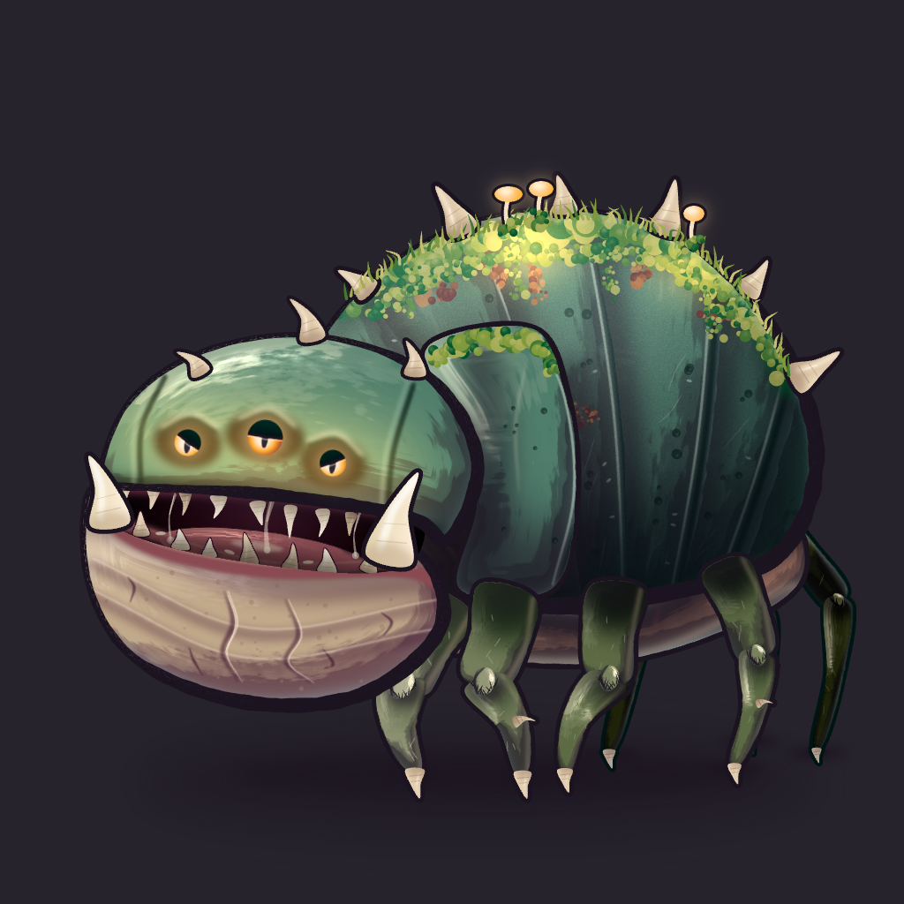

<p align="center">
  <picture>
    <source media="(prefers-color-scheme: dark)" srcset="assets/logo-dark.png">
    
  </picture>
</p>

<p align="center">
  A language for procedural art that a language model can write and check.<br>
  The CLI builds <code>.ramo</code> files into PNG, SVG, and GIF.
</p>

<p align="center">
  <a href="rust-toolchain.toml"></a>
  <a href="docs/language.md"></a>
  <a href="LICENSE"></a>
</p>

<p align="center">
  
</p>

<p align="center"><sub>The bogmaw, from 199 lines of <a href="examples/spire/art/monster/bogmaw.ramo">ramose</a>.</sub></p>

---

A model can draw one asset in SVG. It has trouble drawing the hundredth in the same style, changing one detail without rewriting the file, and telling whether its output is right. ramose keeps style in palettes and components, and `ramose check` reports each broken rule with a line number and a fix.

## The bogmaw

[`examples/spire`](examples/spire) draws one monster. The moss on its back is a stamp, a block of drawing repeated along a curve:

```
stamp clump spacing:7 r:9 tone:p.moss.2
  each j in 0..3
    circle r*(.3+1*rand(0 1)*rand(0 1)+.15) at:rand(-7 7),rand(-6 10)+j*3 fill:pick([shade(tone -2) shade(tone -1) tone shade(tone 1)]) name:bit
      circle r*.35 at:0-r*.2,0-r*.3 fill:shade(tone 2) a:.55 blur:2
```

Each copy picks its own sizes and shades from a seed, so the moss varies and the build stays the same every time. One line lays it along the shell:

```
curve 380,345 470,290 560,262 640,250 720,258 800,296 856,356 896,430 fill:none stamp:clump(r:10) name:moss_top
```

The far legs reuse the `leg` component from the near legs. `fx adjust` shifts their hue and darkens them so they sit behind the body:

```
layer legs_far
  leg 640,610 715,705 690,850 w:23 tone:p.leg.2 bend:-6 spur:0 name:leg_f1
  leg 770,615 860,690 850,835 w:21 tone:p.leg.2 bend:-10 name:leg_f2
  leg 870,590 950,680 925,848 w:18 tone:p.leg.2 bend:-8 spur:0 name:leg_f3
  fx adjust hue:-14 light:-.14 sat:-.25
  fx rim 3 dir:1,-1 color:p.rim a:.35
  fx outline 4 color:p.shell.0
```

Every color comes from the 13-row [`bog` palette](examples/spire/lib/palette/bog.ramo), so a recolor is a palette edit. `bogmaw.ramo` is 5,479 tokens, and the brushes, parts, and palette it imports are 2,397 more.

## Other examples

<table>
  <tr>
    <td width="33%" align="center"></td>
    <td width="33%" align="center"></td>
    <td width="33%" align="center"></td>
  </tr>
  <tr>
    <td align="center"><sub><a href="examples/slime">slime</a>: three flavors, animated, from one file</sub></td>
    <td align="center"><sub><a href="examples/chibi">chibi</a>: a character built from a shared face-parts library</sub></td>
    <td align="center"><sub><a href="examples/chibi">chibi</a>: a prop in the same house style</sub></td>
  </tr>
</table>

## Why it suits a model

**Small files.** The core language card, [`docs/language.md`](docs/language.md), is 988 tokens. `ramose docs <topic>` prints one of fourteen topics, so a task loads only what it needs.

**Local edits.** Style lives in palettes, components, and named parts. To give the chibi monk blue eyes, change one line:

```diff
-  color iris #9a6a3a
+  color iris #4f7fc0
```

The rebuild changes only the eyes. `ramose fmt` prints one canonical form, so a diff holds only the change.

**Errors with fixes.** `ramose check --json` evaluates the project without rendering and returns each failure with its location and a fix:

```json
{
  "code": "C0101",
  "file": "art/slime.ramo",
  "fix": "set .eye.1 at:50,-114",
  "message": "assert level(@eye.0 @eye.1)",
  "node": "",
  "notes": ["eye.cy = 266   eye.cy = 274   difference 8 > tol 0.5"],
  "severity": "error",
  "span": { "col": 1, "line": 33 }
}
```

**Checks instead of eyes.** `assert` and `expect` lines state the composition rules, such as eyes level or the body inside the canvas with a margin. `ramose explain` prints every node with its bounds and colors, so a model can find where things are without looking at a render.

**Many files, one style.** Projects share palettes and component libraries with `use`. One `@target` line builds every variant in a matrix. `build --only 'monster/*'` renders only the matching files, so several agents can work in one project. Builds are deterministic on one machine and backend, and `art-manifest.json` records a hash for each output.

## One file, three slimes

This is all of [`examples/slime/art/slime.ramo`](examples/slime/art/slime.ramo), 435 tokens. It builds three PNGs and three GIFs:

```
@target slime_{flavor}.png 512x512 each flavor:[mint grape peach]
@target slime_{flavor}.gif 240x240 bg:#fbf6ee fps:24 each flavor:[mint grape peach]

palette goo
  ramp mint #7fd4a8 5
  ramp grape #b49cf0 5
  ramp peach #f7a98c 5
  color ink #2b2440
  color shine #ffffff

let jelly = if flavor == grape then goo.grape else if flavor == peach then goo.peach else goo.mint

layer slime scale:canvas.w/512
  ellipse 160,22 at:256,392 fill:goo.ink a:.2 blur:10
  group at:256,380 name:squash
    curve -150,0 -140,-120 -60,-220 60,-220 140,-120 150,0 closed tension:.5 fill:grad(down jelly.3 jelly.1) name:body
      ellipse 50,30 at:-60,-170 rot:-30 fill:jelly.4 a:.8 blur:8
      subtract fill:jelly.0 a:.4 blur:3
        copy @body
        copy @body at:-24,-20
      each s in [-1 1]
        circle 18 at:50*s,-110 fill:goo.ink name:eye
          circle 6 at:-6,-6 fill:goo.shine
      curve -22,-70 0,-56 22,-70 stroke:goo.ink,[3 6 3] taper:.3
      fx rim 6 dir:1,1 color:goo.shine a:.4
      fx outline 6 color:jelly.line

anim wobble dur:1.2s loop
  .squash scale:key(1,1 1.08,.92 .96,1.04 1,1)

play wobble

assert level(@eye.0 @eye.1)
assert inside(@body canvas margin:24)
```

<p align="center">
  
  
  
</p>

- `ramp mint #7fd4a8 5` makes five stops, with cooler shadows and warmer lights. `jelly.line` is a matching outline color. A new flavor is one palette row.
- The highlight, shadow, and eyes are children of `body`, so ramose clips them to it. A wrong coordinate cannot push them outside the slime.
- The shadow is the body minus a shifted copy of itself. Reshape the body and the shadow follows.
- `anim wobble` scales the `squash` group over time. The PNG draws the rest pose, and the GIF plays the loop.
- Move one eye with `at:50*s,-110+4*s` and `check` exits 2 with the diagnostic above. It checks every GIF frame and reports the worst one.

## The agent loop

1. Give the model `ramose docs <topic>...` for the topics the task needs, and the project's palettes and component libraries.
2. The model writes or edits a `.ramo` file.
3. Run `ramose check --json`. Return the diagnostics to the model until the command exits 0.
4. Run `ramose build --only '<its files>'`.
5. Review the source diff and the changed hashes in `art-manifest.json`.

## What the language covers

| | |
|---|---|
| **Shapes** | `rect`, `circle`, `ellipse`, `poly`, `star`, `curve`, `blob`, SVG `path`, `edge` (a stretch of another shape's contour), booleans (`subtract`, `union`, `intersect`, `xor`), `mirror`, `repeat`, `grid` |
| **Ink** | Tapered strokes with one width per point, hand-drawn `jitter`, round caps and joins |
| **Brushes and stamps** | SkSL brushes that shade a fill or stroke, and stamps that repeat a block of drawing along a path |
| **Color** | Hue-shifted ramps, OKLCH gradients (linear, radial, conic), `shade`, `mix`, `fade` |
| **Texture** | `simplex`, `perlin`, `worley`, and `fbm` noise, as fills or masks |
| **Effects** | `rim`, `outline`, `glow`, `shadow`, `inner`, `grain`, `blur`, `adjust`, and reusable `finish` stacks |
| **Components** | `def` with typed parameters, slots, anchors, and `.part` overrides, shared with `use` |
| **Motion** | `anim` clips with keyframes and easing, played into GIFs |
| **Output** | PNG at any scale, SVG, GIF, and `art-manifest.json` |
| **Checks** | `assert` and `expect` on position, size, alignment, symmetry, overlap, and stroke width |

## Get started

ramose builds with stable Rust.

```sh
cargo install --git https://github.com/tvanhens/ramose ramose
```

Make a project and build it:

```sh
mkdir my-art && cd my-art
ramose init
ramose build
```

`init` writes a manifest, a starter palette, and `art/hello.ramo`. `build` writes `assets/hello.png`, `assets/hello@2x.png`, and `assets/art-manifest.json`.

| Command | What it does |
|---|---|
| `ramose build [--only GLOB]...` | Render every `@target` and write the manifest |
| `ramose check [--json]` | Evaluate every target and run its checks, without rendering |
| `ramose fmt [--check]` | Rewrite `.ramo` files in the canonical style |
| `ramose explain <file>` | Print the evaluated node tree |
| `ramose docs [TOPIC]...` | Print the language card or the named topics |
| `ramose init` | Create a starter project |

## Learn more

- [`docs/language.md`](docs/language.md) is the core language card. [`docs/topics/`](docs/topics) has one file per topic.
- [`examples/spire`](examples/spire) is the bogmaw, with its own brushes, stamps, and parts library.
- [`examples/chibi`](examples/chibi) has a shared palette, a face-parts library, and an animated character.
- [`assets/logo.ramo`](assets/logo.ramo) draws the logo. The wordmark is [Inter](https://rsms.me/inter/), under the SIL Open Font License.

ramose is a v0.1 draft. Expect breaking changes.

## License

ramose is source-available under the [Business Source License 1.1](LICENSE).

- **Free.** Use ramose to make art for your own games, apps, and other projects, including commercial ones. The images and animations you build are yours, and the license places no restriction on them.
- **Needs a commercial license.** You need one to offer ramose to other people as part of a platform, such as a hosted or API asset generator, a game engine or editor that includes it, or an AI product that writes ramose for its users. [Contact the author](https://github.com/tvanhens) for terms.

Each version becomes available under the Apache License 2.0 four years after its release. [`LICENSE`](LICENSE) has the full terms.
