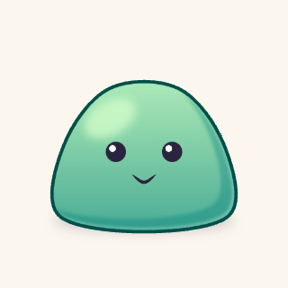

<p align="center">
  <picture>
    <source media="(prefers-color-scheme: dark)" srcset="assets/logo-dark.png">
    
  </picture>
</p>

<h1 align="center">artscript</h1>

<p align="center">
  <b>Illustration you can diff.</b><br>
  Write vector art as plain text. Build it to PNG, SVG, and GIF.
</p>

<p align="center">
  
</p>

<p align="center">
  
  
  
  
  
</p>

<p align="center"><sub>Every pixel above is built from an <code>.art</code> file in <a href="examples/chibi"><code>examples/chibi</code></a>. No editor, no binary project file, no hand-exported frames.</sub></p>

---

artscript is a small declarative language and a CLI. You describe shapes, palettes, shading, and motion in an indented text file. `artscript build` renders every target the file declares, the same bytes every time.

Because the art is text, everything you already do with code works on it. You review a pull request that changes a character's eye color. You `git bisect` the commit that made the leaf droop. You loop over seeds, reuse components across files, and put an assertion on the composition so that nobody breaks it by accident.

## A slime in 30 lines

This is the whole of [`examples/slime/art/slime.art`](examples/slime/art/slime.art):

```
@target slime.png 512x512
@target slime.gif 320x320 bg:#fbf6ee fps:24

palette goo
  ramp jelly #7fd4a8 5
  color ink #2b2440
  color shine #ffffff

layer slime scale:canvas.w/512
  ellipse 160,22 at:256,392 fill:goo.ink a:.2 blur:10
  group at:256,380 name:squash
    curve -150,0 -140,-120 -60,-220 60,-220 140,-120 150,0 closed tension:.5 fill:grad(down goo.jelly.3 goo.jelly.1) name:body
      ellipse 50,30 at:-60,-170 rot:-30 fill:goo.jelly.4 a:.8 blur:8
      subtract fill:goo.jelly.0 a:.4 blur:3
        copy @body
        copy @body at:-24,-20
      each s in [-1 1]
        circle 18 at:50*s,-110 fill:goo.ink name:eye
          circle 6 at:-6,-6 fill:goo.shine
      curve -22,-70 0,-56 22,-70 stroke:goo.ink,[3 6 3] taper:.3
      fx rim 6 dir:1,1 color:goo.shine a:.4
      fx outline 6 color:goo.jelly.line

anim wobble dur:1.2s loop
  .squash scale:key(1,1 1.08,.92 .96,1.04 1,1)

play wobble

assert level(@eye.0 @eye.1)
assert inside(@body canvas margin:24)
```

<p align="center">
  
</p>

A lot happens in those lines:

- **One color in, a full ramp out.** `ramp jelly #7fd4a8 5` makes five stops. The shadows shift toward cool teal and the lights toward warm yellow, so `jelly.0` and `jelly.4` look painted, not just darker and lighter. `jelly.line` is a matching outline color.
- **Children clip to their parent.** The highlight, the cel shadow, and the eyes are indented under `body`, so none of them can spill outside it.
- **Shapes are values.** The cel shadow is the body minus a copy of the body nudged up and left. Move the body and the shadow follows.
- **Loops and names.** `each s in [-1 1]` draws both eyes. The checks address them as `@eye.0` and `@eye.1`.
- **Motion is a patch.** `anim wobble` scales the `squash` group over time. The PNG draws the rest pose, and the GIF plays the loop.

## Art that checks itself

An `assert` measures the finished scene. Tilt the face by changing the eye line to `at:50*s,-110+4*s`, and the check fails:

```
$ artscript check
error[C0101] art/slime.art:29:1
  assert level(@eye.0 @eye.1)
  eye.cy = 266   eye.cy = 274   difference 8 > tol 0.5
  fix: set .eye.1 at:50,-114

error[C0101] art/slime.art:29:1
  assert level(@eye.0 @eye.1)
  eye.cy = 171.97   eye.cy = 176.57   difference 4.6 > tol 0.5
  first at 0s
  worst at 0.375s
  fix: set .eye.1 at:50,-114
```

The first error is the PNG. The second is the GIF, where the check runs on every sampled frame and reports the worst moment. `check` exits 2, so CI can gate on it. Lints work the same way. They warn when a shape falls off the canvas or a raw hex color skips the palette, and they name the file, the line, and a fix.

## When you want to see the tree

`artscript explain` prints what the file evaluated to: each node, its bounds, its resolved colors, and the line that drew it.

```
$ artscript explain art/slime.art
canvas 512x512
slime  layer  95.37,148.1 321.26x265.9  (art/slime.art:9)
  slime.ellipse~1  shape  96,370 320x44  fill:#2b2440  blur:10  a:0.2  (art/slime.art:10)
  squash  group  95.37,148.1 321.26x260.89  (art/slime.art:11)
    body  shape  95.37,148.1 321.26x260.89  fill:linear(#aae8b7..#49ac95)  [fx rim 6 #ffffff66]  [fx outline 6 #004f48]  (art/slime.art:12)
      body.ellipse~1  shape  137.7,159.02 116.6x101.96  fill:#d2fcca  blur:8  a:0.8  (art/slime.art:13)
      body.subtract~1  shape  100.27,164.6 316.36x244.39  fill:#0a847f  blur:3  a:0.4  (art/slime.art:14)
      eye.0  shape  188,252 36x36  fill:#2b2440  (art/slime.art:18)
  ...
```

## What's in the box

| | |
|---|---|
| **Shapes** | `rect`, `circle`, `ellipse`, `poly`, `star`, `curve`, `blob`, SVG `path`, booleans (`subtract`, `union`, `intersect`, `xor`), `mirror`, `repeat`, `grid` |
| **Ink** | Tapered brush strokes with one width per point, hand-drawn `jitter`, round caps and joins |
| **Color** | Hue-shifted ramps, OKLCH gradients (linear, radial, conic), `shade`, `mix`, `fade` |
| **Texture** | `simplex`, `perlin`, `worley`, and `fbm` noise fields, as fills or as masks |
| **Effects** | `rim`, `outline`, `glow`, `shadow`, `inner`, `grain`, `blur`, `adjust`, and named `finish` stacks you reuse |
| **Components** | `def` with typed parameters, slots, anchors, and `.part` overrides, shared across files with `use` |
| **Motion** | `anim` clips with keyframes and easing. One target line fans out a GIF per clip |
| **Output** | PNG at any `@2x` scale, SVG, GIF, and an `art-manifest.json` with a hash for each file |
| **Checks** | `assert` and `expect` on positions, sizes, alignment, symmetry, and overlap |

## Get started

artscript builds with stable Rust.

```sh
git clone https://github.com/tvanhens/artscript
cd artscript
cargo install --path crates/cli
```

Make a project, then build it:

```sh
mkdir my-art && cd my-art
artscript init
artscript build
```

`init` writes a manifest, a starter palette, and `art/hello.art`. `build` writes `assets/hello.png`, `assets/hello@2x.png`, and `assets/art-manifest.json`. Open `art/hello.art` and start drawing.

| Command | What it does |
|---|---|
| `artscript build [--only GLOB]` | Render every `@target` and write the manifest |
| `artscript check [--json]` | Evaluate every target and run its checks, without rendering |
| `artscript fmt [--check]` | Rewrite `.art` files in the one canonical style |
| `artscript explain <file>` | Print the evaluated node tree |
| `artscript init` | Create a starter project |

## Learn the language

- [`docs/language.md`](docs/language.md) is the one-page language card. Read it first.
- [`docs/semantics.md`](docs/semantics.md) holds the details the card leaves out.
- [`examples/chibi`](examples/chibi) is a full project with a shared palette, a face-parts library, and an animated character.

artscript is a v0.1 draft. The design is still open, and a better rule can replace any rule in the docs, even when it changes today's output.
