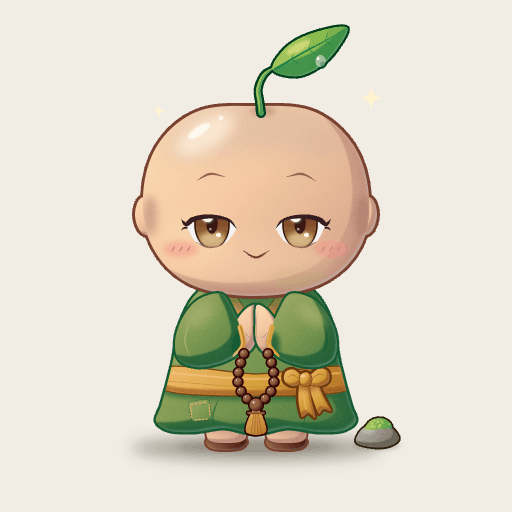
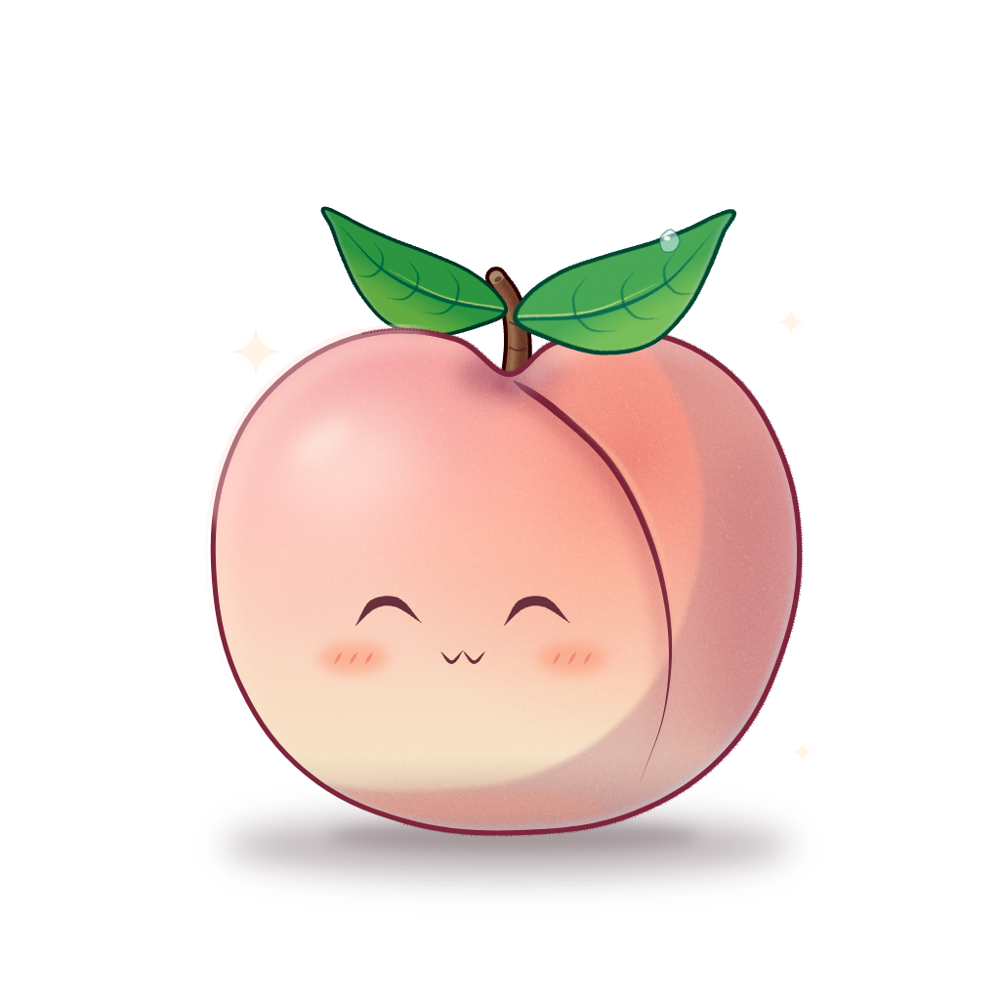
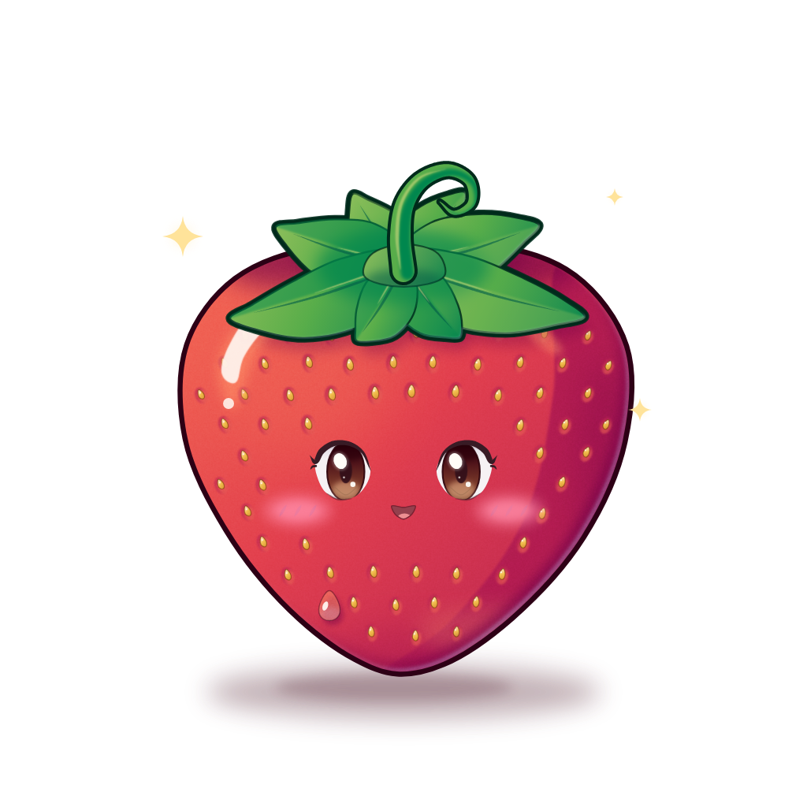
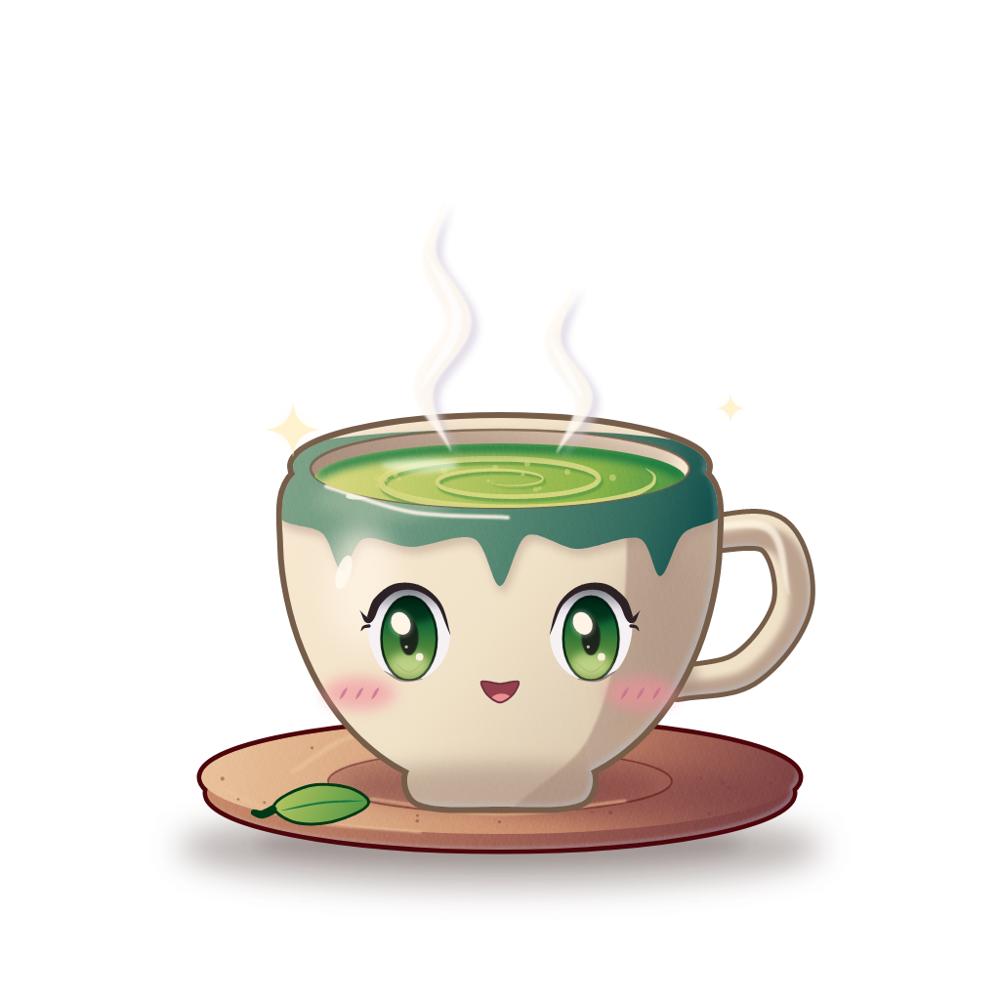
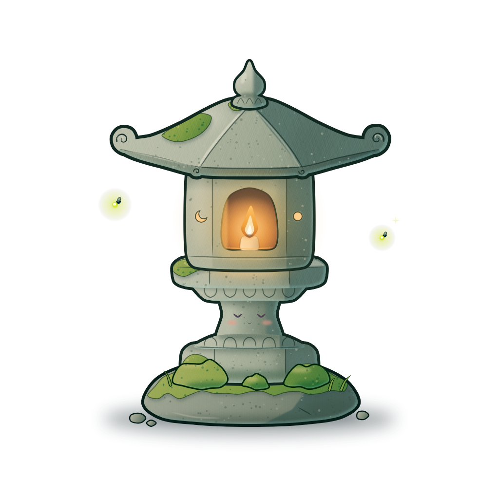
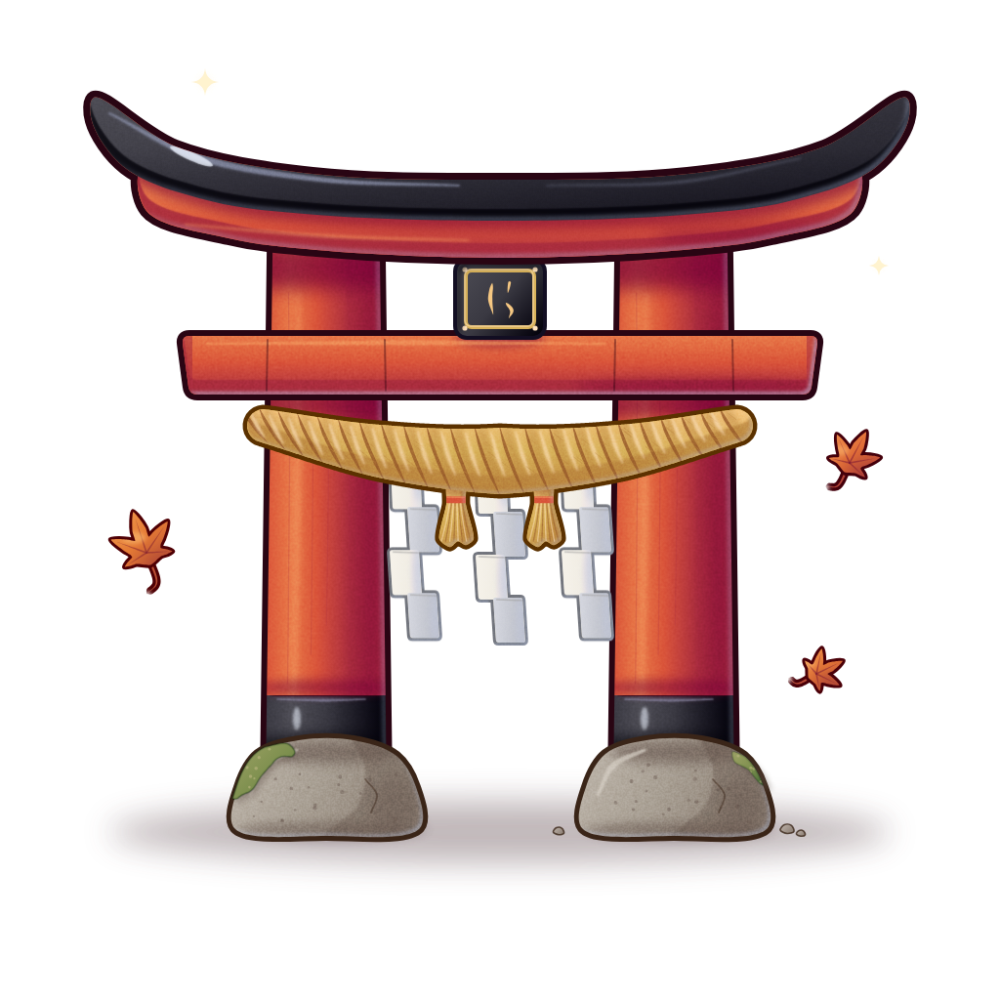
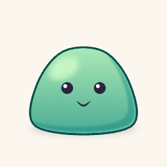
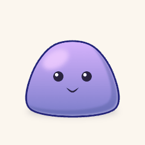
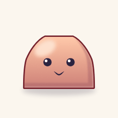

<p align="center">
  <picture>
    <source media="(prefers-color-scheme: dark)" srcset="assets/logo-dark.png">
    
  </picture>
</p>

<h1 align="center">artscript</h1>

<p align="center">
  <b>Art assets your LLM can write, read, and fix.</b><br>
  A compact language for vector illustration, and a CLI that builds it to PNG, SVG, and GIF.
</p>

<p align="center">
  
</p>

<p align="center">
  
  
  
  
  
</p>

---

A game or an app needs hundreds of icons, characters, props, and their variants. A model can draw one of them in SVG. It struggles to draw the hundredth in the same style, to change one detail without regenerating the file, or to tell whether its own output is right.

## Built for the model's side of the loop

**Small enough to write in one turn.** The six chibi pieces average 4,135 tokens each. The SVGs they build are 43 times larger. The core language card, [`docs/language.md`](docs/language.md), is 644 tokens. `artscript docs <topic>` adds only the topics a task needs, and all eleven together are 5,236 tokens.

| Piece | `.art` tokens | Built `.svg` tokens (vector markup only) |
|---|---:|---:|
| `character/moss_monk` | 4,638 | 128,721 |
| `monument/stone_lantern` | 6,521 | 40,257 |
| `monument/vermilion_torii` | 5,034 | 106,462 |
| `produce/momo_peach` | 3,540 | 624,507 |
| `produce/sweet_strawberry` | 2,529 | 84,302 |
| `prop/matcha_teacup` | 2,549 | 91,884 |

**Edits stay local.** Style lives in palettes, components, and named parts, not in baked coordinates. To give the monk blue eyes, a model changes one line:

```diff
-  color iris #9a6a3a
+  color iris #4f7fc0
```

Rebuilt, only the eyes change. Every other pixel is identical. `artscript fmt` prints one canonical form, so diffs carry only what changed.

**Feedback a model can act on.** `artscript check` evaluates a whole project without rendering. The chibi project checks in about a second. `--json` gives the agent the location and a fix:

```json
{
  "code": "C0101",
  "file": "art/slime.art",
  "fix": "set .eye.1 at:50,-114",
  "message": "assert level(@eye.0 @eye.1)",
  "node": "",
  "notes": ["eye.cy = 266   eye.cy = 274   difference 8 > tol 0.5"],
  "severity": "error",
  "span": { "col": 1, "line": 33 }
}
```

**Eyes optional.** A model doesn't need to look at a render to know where things are. `assert` and `expect` lines encode the composition rules: eyes level, the body inside the canvas with a margin, the head as wide as the body. `artscript explain` prints every node with its bounds and resolved colors as text.

**Made for big projects.** Shared palettes and component libraries (`use face/parts { eye blush }`) keep a house style across files. One `@target` line fans out every variant in a matrix. `build --only 'character/*'` lets each agent render just the files it owns. Builds are deterministic, and `art-manifest.json` records a hash per output, so a reviewer sees exactly which assets changed.

## One file, three slimes

This is all of [`examples/slime/art/slime.art`](examples/slime/art/slime.art). It builds three PNGs and three animated GIFs:

```
@target slime_{flavor}.png 512x512 each flavor:[mint grape peach]
@target slime_{flavor}.gif 240x240 bg:#fbf6ee fps:24 each flavor:[mint grape peach]

palette goo
  ramp mint #7fd4a8 5
  ramp grape #b49cf0 5
  ramp peach #f7a98c 5
  color ink #2b2440
  color shine #ffffff

let jelly = if flavor == grape then goo.grape else if flavor == peach then goo.peach else goo.mint

layer slime scale:canvas.w/512
  ellipse 160,22 at:256,392 fill:goo.ink a:.2 blur:10
  group at:256,380 name:squash
    curve -150,0 -140,-120 -60,-220 60,-220 140,-120 150,0 closed tension:.5 fill:grad(down jelly.3 jelly.1) name:body
      ellipse 50,30 at:-60,-170 rot:-30 fill:jelly.4 a:.8 blur:8
      subtract fill:jelly.0 a:.4 blur:3
        copy @body
        copy @body at:-24,-20
      each s in [-1 1]
        circle 18 at:50*s,-110 fill:goo.ink name:eye
          circle 6 at:-6,-6 fill:goo.shine
      curve -22,-70 0,-56 22,-70 stroke:goo.ink,[3 6 3] taper:.3
      fx rim 6 dir:1,1 color:goo.shine a:.4
      fx outline 6 color:jelly.line

anim wobble dur:1.2s loop
  .squash scale:key(1,1 1.08,.92 .96,1.04 1,1)

play wobble

assert level(@eye.0 @eye.1)
assert inside(@body canvas margin:24)
```

<p align="center">
  
  
  
</p>

The file is 435 tokens.

- **One color in, a painted ramp out.** `ramp mint #7fd4a8 5` makes five stops whose shadows shift cool and whose lights shift warm. `jelly.line` is a matching outline color. A new flavor is one palette row.
- **Children clip to their parent.** The highlight, the shadow, and the eyes sit under `body`, so none of them can spill outside it, whatever the model gets wrong about coordinates.
- **Shapes are values.** The shadow is the body minus a nudged copy of itself. Reshape the body and the shadow follows.
- **Motion is a patch.** `anim wobble` scales the `squash` group over time. The PNG draws the rest pose, and the GIF plays the loop.
- **The rules travel with the art.** Tilt the eyes with `at:50*s,-110+4*s` and `check` exits 2 with the diagnostic shown above. It checks every GIF frame too, and it reports the worst moment.

## The agent loop

1. Give the model the output of `artscript docs <topic>...` for the topics the task touches, and the project's palette and component libraries.
2. The model writes or edits an `.art` file.
3. Run `artscript check --json`. Feed any diagnostics back, and repeat until it exits 0.
4. Run `artscript build --only '<its files>'` to render.
5. Review the source diff and the changed hashes in `art-manifest.json`.

## What the language covers

| | |
|---|---|
| **Shapes** | `rect`, `circle`, `ellipse`, `poly`, `star`, `curve`, `blob`, SVG `path`, booleans (`subtract`, `union`, `intersect`, `xor`), `mirror`, `repeat`, `grid` |
| **Ink** | Tapered brush strokes with one width per point, hand-drawn `jitter`, round caps and joins |
| **Color** | Hue-shifted ramps, OKLCH gradients (linear, radial, conic), `shade`, `mix`, `fade` |
| **Texture** | `simplex`, `perlin`, `worley`, and `fbm` noise fields, as fills or as masks |
| **Effects** | `rim`, `outline`, `glow`, `shadow`, `inner`, `grain`, `blur`, `adjust`, and named `finish` stacks you reuse |
| **Components** | `def` with typed parameters, slots, anchors, and `.part` overrides, shared across files with `use` |
| **Motion** | `anim` clips with keyframes and easing, played into GIFs |
| **Output** | PNG at any `@2x` scale, SVG, GIF, and `art-manifest.json` |
| **Checks** | `assert` and `expect` on position, size, alignment, symmetry, overlap, and stroke width |

## Get started

artscript builds with stable Rust.

```sh
git clone https://github.com/tvanhens/artscript
cd artscript
cargo install --path crates/cli
```

Make a project, then build it:

```sh
mkdir my-art && cd my-art
artscript init
artscript build
```

`init` writes a manifest, a starter palette, and `art/hello.art`. `build` writes `assets/hello.png`, `assets/hello@2x.png`, and `assets/art-manifest.json`.

| Command | What it does |
|---|---|
| `artscript build [--only GLOB]` | Render every `@target` and write the manifest |
| `artscript check [--json]` | Evaluate every target and run its checks, without rendering |
| `artscript fmt [--check]` | Rewrite `.art` files in the canonical style |
| `artscript explain <file>` | Print the evaluated node tree |
| `artscript init` | Create a starter project |

## Learn more

- [`docs/language.md`](docs/language.md) is the core language card, and [`docs/topics/`](docs/topics) holds one file per topic. `artscript docs` prints both.
- [`examples/chibi`](examples/chibi) is a full project with a shared palette, a face-parts library, and an animated character.

artscript is a v0.1 draft. Expect breaking changes.
